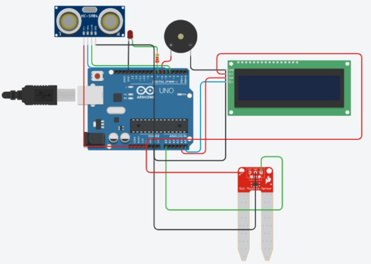
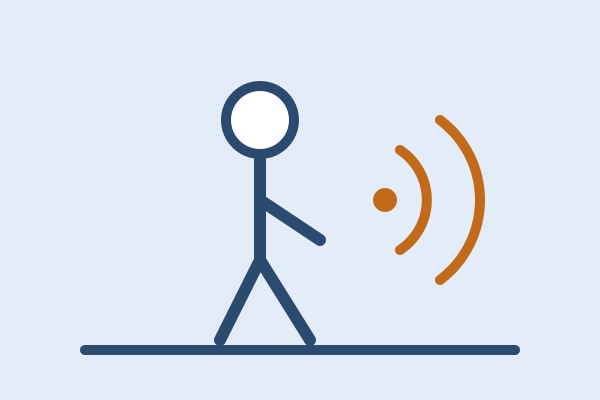
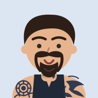

# Documentação técnica – Site Cuida Mais

Este documento explica como o site foi feito, arquivo por arquivo, para apoiar a documentação do projeto.

## 1. Tecnologias usadas

| Tecnologia | Para que serve no projeto |
|---|---|
| **HTML5** | Estrutura e conteúdo das seções |
| **CSS3** | Visual: cores, layout em grade (grid) e adaptação ao celular |
| **JavaScript (ES6)** | Máscaras do formulário, validação e consulta à API de CEP |
| **API ViaCEP** | Serviço gratuito que devolve o endereço a partir do CEP |
| **SVG** | Formato de imagem vetorial usado nas ilustrações e nos avatares |
| **GitHub Pages** | Hospedagem gratuita do site |

Não foi usado nenhum framework nem biblioteca externa. Só as fontes do Google (Outfit e Nunito Sans).

## 2. Estrutura de arquivos

```
site/
├── index.html          estrutura e textos da página
├── style.css           aparência (cores, layout, responsivo)
├── script.js           comportamento e consulta à API
├── README.md           resumo do projeto para o GitHub
├── DOCUMENTACAO.md     este documento
└── images/
    ├── instituicao.svg     imagem da empresa
    ├── circuito-arduino.png    esquema do circuito Arduino (seção #circuito)
    ├── quedas.svg, pressao.svg, rotina.svg    imagens das soluções
    └── avatar-*.svg        avatares da equipe
```

## 3. Seções do `index.html`

Cada seção tem um `id`, que é usado pelos links do menu (por exemplo `href="#solucoes"`) para rolar a página até ela.

| `id` | Conteúdo | Requisito do trabalho |
|---|---|---|
| `#inicio` | Título, frase de apresentação e imagem da empresa | 2 |
| `#quem-somos` | Texto institucional | – |
| `#mvv` | Missão, visão e valores | – |
| `#historia` | Linha do tempo | 1 |
| `#solucoes` | 3 cards com imagem e texto | 3 |
| `#circuito` | Esquema do circuito Arduino e lista de componentes | – |
| `#equipe` | Avatar, nome, função e RA de cada integrante | 4 |
| `#contato` | Formulário com consulta de CEP | 5 e 6 |

### 3.1 Seção do circuito (`#circuito`)

Seção com o esquema do circuito Arduino usado no projeto. Tem um texto de apresentação, a imagem (dentro de `<figure>`, com legenda em `<figcaption>`) e a lista de componentes. A imagem é um PNG enviado pelo grupo, guardado em `images/circuito-arduino.png`.

```html
<section id="circuito" class="secao">
  <h2>O circuito do projeto</h2>
  <p class="texto-largo destaque-texto">Este é o circuito utilizado no nosso projeto...</p>
  <div class="circuito">
    <figure>
      
      <figcaption>Esquema do circuito com Arduino UNO</figcaption>
    </figure>
    <div>
      <h3>O circuito conta com:</h3>
      <ul class="componentes">
        <li><strong>LED</strong> que acende quando qualquer uma das condições for atendida</li>
        <!-- sensor de proximidade, tela LCD 16x2, sensor de umidade e buzzer -->
      </ul>
    </div>
  </div>
</section>
```

O link do menu (`<a href="#circuito">Circuito</a>`) leva até a seção, funcionando como uma aba de navegação.

Componentes do circuito:

| Componente | Função no projeto |
|---|---|
| LED | Acende quando qualquer uma das condições for atendida |
| Sensor de proximidade | Fica perto da cama do idoso para monitoramento |
| Tela LCD 16x2 | Avisa a equipe sobre o estado do idoso |
| Sensor de umidade | Monitora a fralda do idoso |
| Buzzer | Emite um aviso sonoro |

Exemplo de card de solução (imagem + texto):

```html
<article class="cartao">
  
  <h3>Prevenção de quedas</h3>
  <p>Sensores inteligentes ajudam a identificar situações de risco...</p>
</article>
```

Exemplo de integrante da equipe:

```html
<div class="membro">
  
  <h3>Gabriel Charete Del’labon</h3>
  <p>Desenvolvedor do site</p>
  <small class="ra">RA: 324200597</small>
</div>
```

O atributo `alt` descreve a imagem para leitores de tela e aparece se a imagem não carregar.

## 4. Como o `style.css` funciona

**Variáveis de cor.** Todas as cores ficam em `:root`. Para mudar o tema inteiro basta alterar estas linhas:

```css
:root{
  --primaria:#2B4A6F;   /* topo, títulos, botões */
  --destaque:#B85C12;   /* hover e linha do tempo */
  --fundo-hero:#E8EEF5;
  --cinza:#F3F5F8;
}
```

**Layout em grade.** Os cards de soluções e da equipe usam CSS Grid. O `auto-fit` com `minmax` faz as colunas se ajustarem sozinhas ao tamanho da tela:

```css
.grade{
  display:grid;
  grid-template-columns:repeat(auto-fit,minmax(240px,1fr));
  gap:24px;
}
```

**Avatar redondo.** A imagem quadrada vira círculo com `border-radius:50%`:

```css
.avatar{width:112px;height:112px;border-radius:50%;object-fit:cover;display:block;margin:0 auto 12px}
```

**Seção do circuito.** A imagem e a lista ficam lado a lado em duas colunas (`grid-template-columns:1.1fr 1fr`). No celular, o `@media` coloca uma embaixo da outra:

```css
.circuito{display:grid;grid-template-columns:1.1fr 1fr;gap:32px;align-items:start}
.circuito figure img{width:100%;border-radius:12px}
@media (max-width:700px){ .circuito{grid-template-columns:1fr} }
```

**Celular.** No final do arquivo, o `@media (max-width:700px)` coloca tudo em uma coluna.

## 5. Como o `script.js` funciona

### 5.1 Parâmetros (`CONFIG`)
No topo do arquivo ficam os valores que mais mudam: a URL da API, as opções do campo "Você é" e a mensagem do CEP.

### 5.2 Máscaras
Enquanto a pessoa digita, o código remove o que não é número (`replace(/\D/g, '')`) e insere os símbolos no lugar certo:

```js
campoCep.addEventListener('input', () => {
  let v = campoCep.value.replace(/\D/g, '').slice(0, 8);
  if (v.length > 5) v = v.slice(0, 5) + '-' + v.slice(5);
  campoCep.value = v;
  if (v.length === 9) buscarCep(v);
});
```

### 5.3 Consulta à API ViaCEP (requisito 6)
Quando o CEP está completo, a função `buscarCep` faz uma requisição HTTP à API e preenche rua, bairro e cidade:

```js
async function buscarCep(cep) {
  const numeros = cep.replace(/\D/g, '');
  try {
    const url = CONFIG.urlCep.replace('{cep}', numeros);
    const resposta = await fetch(url);       // pede os dados à API
    const dados = await resposta.json();     // converte a resposta em objeto

    if (dados.erro) { /* CEP não existe */ return; }

    $('rua').value    = dados.logradouro;
    $('bairro').value = dados.bairro;
    $('cidade').value = `${dados.localidade} / ${dados.uf}`;
  } catch (erro) {
    /* sem internet ou API fora do ar */
  }
}
```

Pontos para citar na documentação:
- `fetch` faz a requisição e `async/await` espera a resposta sem travar a página.
- A API responde em **JSON**. Os campos usados são `logradouro`, `bairro`, `localidade` e `uf`.
- Se o CEP não existe, a ViaCEP devolve `{ "erro": true }`. O código trata esse caso e também a falha de conexão (`try/catch`).
- Exemplo de chamada: `https://viacep.com.br/ws/01001000/json/`

### 5.4 Validação do formulário (requisito 5)
No envio, o `e.preventDefault()` impede a página de recarregar. Depois cada campo é conferido em sequência, e o primeiro problema encontrado vira a mensagem de erro. Se tudo estiver certo, é exibida uma mensagem de sucesso. O envio é simulado, pois o site não tem servidor.

## 6. Como os avatares foram feitos

Os avatares são arquivos **SVG**, que são imagens descritas por texto (formas geométricas). Cada um tem 200 x 200 e é montado em **camadas**, da de trás para a da frente:

1. fundo colorido (`<rect>`)
2. cabelo de trás (quando é comprido)
3. ombros e roupa (`<path>`)
4. pescoço
5. orelhas e rosto (`<circle>`, `<ellipse>`)
6. cabelo da frente, sobrancelhas, olhos, nariz
7. detalhes: óculos, barba, tatuagens, sorriso

Exemplo simplificado de um avatar:

```svg
<svg xmlns="http://www.w3.org/2000/svg" viewBox="0 0 200 200">
  <rect width="200" height="200" fill="#DDF0EF"/>                       <!-- fundo -->
  <path d="M25 200Q25 158 78 152L122 152Q175 158 175 200Z" fill="#3A8C8C"/>  <!-- ombros -->
  <rect x="84" y="128" width="32" height="38" rx="10" fill="#EBC09C"/>   <!-- pescoço -->
  <ellipse cx="100" cy="95" rx="48" ry="54" fill="#EBC09C"/>            <!-- rosto -->
  <circle cx="80" cy="94" r="4.5" fill="#2b2b2b"/>                       <!-- olho -->
  <circle cx="120" cy="94" r="4.5" fill="#2b2b2b"/>                      <!-- olho -->
  <path d="M86 121Q100 134 114 121" fill="none" stroke="#b24a55"
        stroke-width="4" stroke-linecap="round"/>                       <!-- sorriso -->
</svg>
```

Os comandos de `d="..."` desenham linhas e curvas: `M` move o ponto, `L` traça uma reta, `Q` faz uma curva e `Z` fecha a forma.

Como as imagens são texto, os arquivos são pequenos e não perdem qualidade ao ampliar. Para usar uma foto real, basta trocar o `src` no HTML.

## 7. Publicação

1. Criar um repositório público no GitHub.
2. Enviar o conteúdo da pasta `site` para a raiz do repositório.
3. Em *Settings → Pages*, escolher a branch `main` e a pasta `/ (root)`.
4. O site fica em `https://USUARIO.github.io/REPOSITORIO/`.

## 8. Itens pendentes

- Trocar as etapas provisórias do histórico (`#historia`) pelas datas reais do projeto.
- Conferir os textos das soluções em `#solucoes`.
- Preencher as funções marcadas como "Função a definir" na equipe.
- Preencher os links do GitHub e do site no `README.md`.
